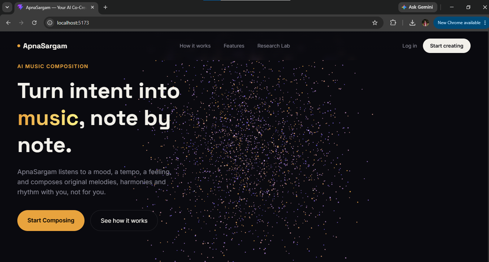
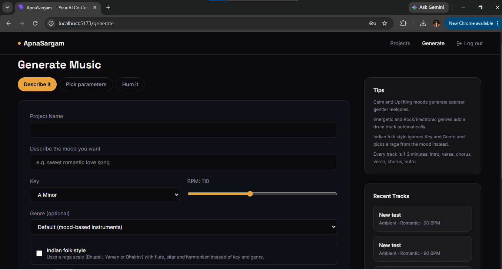
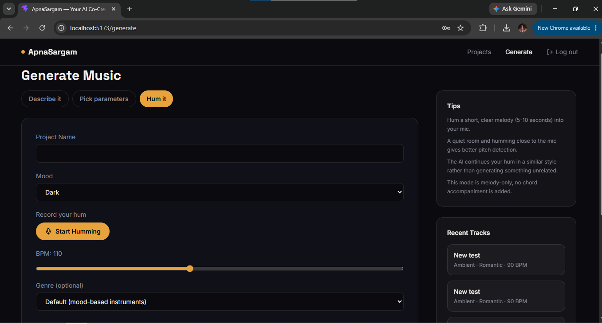
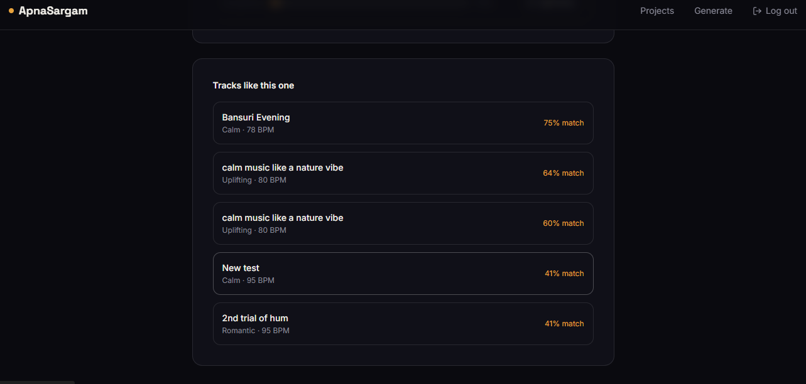
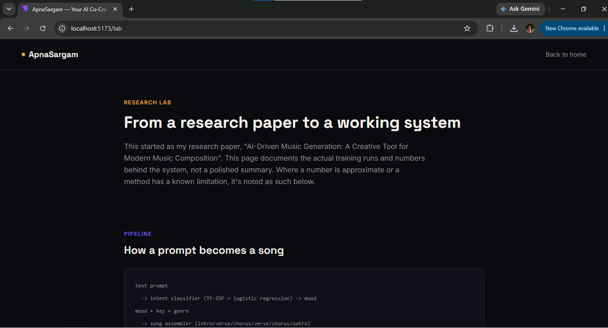

# ApnaSargam


A music generation platform I built end to end. You describe a track in plain text, pick the mood, key and genre yourself, or hum a few seconds into the mic, and it produces a 1-2 minute instrumental as an editable MIDI file. You can play it in the browser, cut and trim it in a small timeline editor, and save it to your projects.

It started as my research paper, "AI-Driven Music Generation: A Creative Tool for Modern Music Composition". I lost the original college code, so this is a full rebuild of the same idea, this time with a real backend, a database and tests.

## Screenshots

| Landing page | Generator |
|---|---|
|  |  |

| Hum it | Project page with similar tracks |
|---|---|
|  |  |



## What it does

- **Describe it**: type a sentence, a classifier picks the mood, a melody model writes the tune.
- **Pick parameters**: choose mood, key, BPM, one of 8 genres (Rock, Jazz, Hip-hop, Electronic, Classical, Cinematic, Lo-fi, Ambient), or switch on Indian folk mode (Bhupali, Yaman or Bhairav raga with flute, sitar and harmonium).
- **Hum it**: record a short hum, the system detects the notes and the model continues your melody.
- **Edit and save**: split and delete parts of a track on a timeline, and save the edited version back to the project.
- **Projects and similar tracks**: every generation is saved, and each project page lists your other tracks that sound like it.
- A public **Research Lab** page (`/lab`) documents the training runs and numbers.

## How it works

```
text prompt -> intent classifier (TF-IDF + logistic regression) -> mood
mood + key + genre -> song assembler (intro/verse/chorus/verse/chorus/outro)
                   -> TCN melody model -> scale or raga constraint layer
                   -> instruments + rule-based drum pattern -> MIDI

hum recording (WAV from the browser) -> pitch detector -> notes
                   -> notes seed the TCN, which continues them -> MIDI
```

Generation runs as a background job (Redis + RQ worker), so the API never blocks while a song is composed.

## Data and pipeline

- **Melody data**: 100 of the 1,034 MIDI files in the Nottingham folk dataset, parsed with music21. Chords are reduced to their top note, each note becomes a (pitch, duration) token, giving a 165-token vocabulary and 13,003 training windows of length 32.
- **Text data**: the public dair-ai/emotion dataset (16,000 train, 2,000 validation). Its 6 emotion labels are mapped to 5 of my 7 moods. The mapping is lossy: Calm and Energetic have no equivalent label, so free text cannot reach them.
- **Storage**: PostgreSQL (users and projects, foreign key and indexes), schema versioned with Alembic. MIDI files live on local disk, and replacing or deleting a track removes the old file.
- **Jobs**: the worker writes the project row itself with its own DB session. RQ keeps job results for only 500 seconds, so the database row is the durable record.
- **Audio**: the browser encodes the hum as a 16-bit WAV, so the backend only needs Python's built-in `wave` module and no ffmpeg.

## Measured results

| What | Result |
|---|---|
| Intent classifier | 87.1% accuracy, 0.873 precision, 0.871 recall, 0.866 F1 on 2,000 held-out examples |
| Hand-written baseline | 21 examples I wrote myself scored 24% accuracy under cross-validation, which is why I switched to a real dataset |
| LSTM baseline | 241,605 parameters, about 4 min training on CPU, final training loss about 0.20 |
| TCN (used in the app) | 120,101 parameters, about 3.2 min training on CPU, final training loss about 0.23 |
| Pitch detector | Correct MIDI note in all 15 pure-tone cases (5 notes x 3 sample rates), and a 5-note melody with harmonics, gaps and added noise recovered note by note |
| Similarity score | First version (cosine on raw features) scored all 15 pairs of 6 synthetic tracks between 98.5% and 99.97%. After standardizing and switching to a Gaussian similarity, a close calm pair scores 88% and calm vs energetic about 0% |

The TCN has half the parameters of the LSTM and trained about 19% faster, at a slightly higher loss. These are single runs on a 4-thread CPU, and the losses are training losses, not held-out, so treat them as indicative.

**Things I tried that did not help** (kept in the commit history):
- More CPU threads made no measurable difference, and batch size 512 trained in the same time with worse loss (0.33). An LSTM is sequential by nature, which is why changing the architecture helped and tuning did not.
- A stride of 8 cut training to 42 seconds but left the model undertrained (loss 2.0 vs 0.2), so I kept stride 1.
- My first version generated by token count and produced a 27-second "song" instead of the 1-2 minutes the song structure calls for. Generating until the requested duration is covered fixed it (about 1 minute 40 afterwards).

## Known limitations

- Genre changes instruments and drum patterns, not the melody model. There is no genre-specific training data.
- The melody model is trained on only 100 folk files, so quality is bounded by that.
- Playback uses a general MIDI soundfont in the browser, so instruments like flute or sitar sound synthetic.
- The pitch detector was tested on synthetic tones and melodies, not on a range of real voices. Repeating the same note with no pause is detected as one long note. Hum mode is melody only (no chords), fixed at 16 bars, and the continuation is inspired by the hum rather than an exact copy.
- The similarity feature uses four hand-picked features (average pitch, pitch range, note density, tempo), so it captures register and tempo but not melody shape or harmony.
- Song generation time was not benchmarked.
- The in-browser player pulls in an old dependency chain that `npm audit` flags. It is client side only and there is no upstream fix, so I documented it instead of hiding it.
- Not deployed anywhere. The job queue endpoints, the hum endpoint and the frontend are not covered by tests.

## Stack

React, TypeScript, Vite, Tailwind. FastAPI, SQLAlchemy, Alembic, PostgreSQL. Redis and RQ for jobs. PyTorch for the melody model, scikit-learn for the classifier, pretty_midi and music21 for MIDI. NumPy for pitch detection. Docker Compose for Postgres and Redis. pytest and GitHub Actions for tests.

## Running it locally

You need Docker, Python 3.12 and Node.

```
# 1. database and redis
cd infrastructure
docker-compose up -d

# 2. backend
cd ../backend
python -m venv venv
venv\Scripts\activate
pip install -r requirements.txt
# create backend/.env with DATABASE_URL, REDIS_URL, SECRET_KEY, ENVIRONMENT
alembic upgrade head

# 3. data and models (dataset is not committed)
# download https://github.com/jukedeck/nottingham-dataset and put the MIDI folder in backend/dataset/
python -m app.generation.train_tcn
python -m app.generation.intent_classifier

# 4. run the api and the worker (two terminals)
uvicorn app.main:app --reload
rq worker generation --url redis://localhost:6379/0 --worker-class rq.worker.SimpleWorker

# 5. frontend
cd ../frontend
npm install
npm run dev
```

The `SimpleWorker` flag is only needed on Windows because the default RQ worker uses `fork`.

## Tests

```
cd backend
python -m pytest -v
```

76 tests cover auth and ownership checks, MIDI export, mood and genre config, pitch detection and similarity. API tests run against a temporary in-memory SQLite database, so no Postgres or Redis is needed, and CI runs them on every push.

## License

MIT
